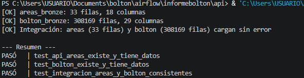
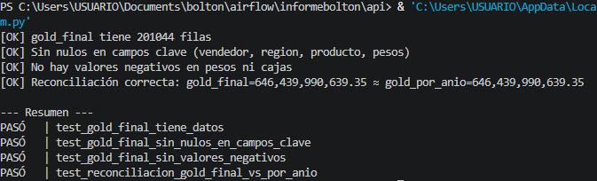
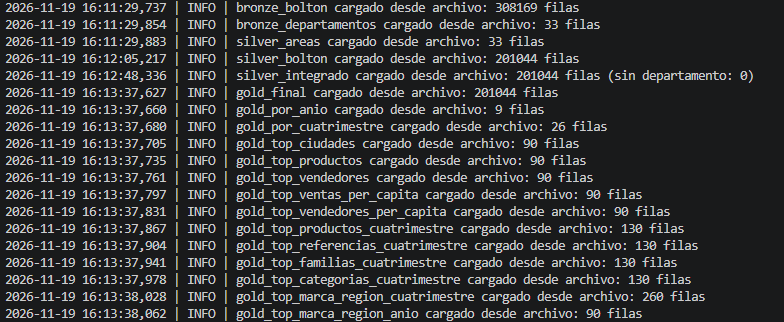
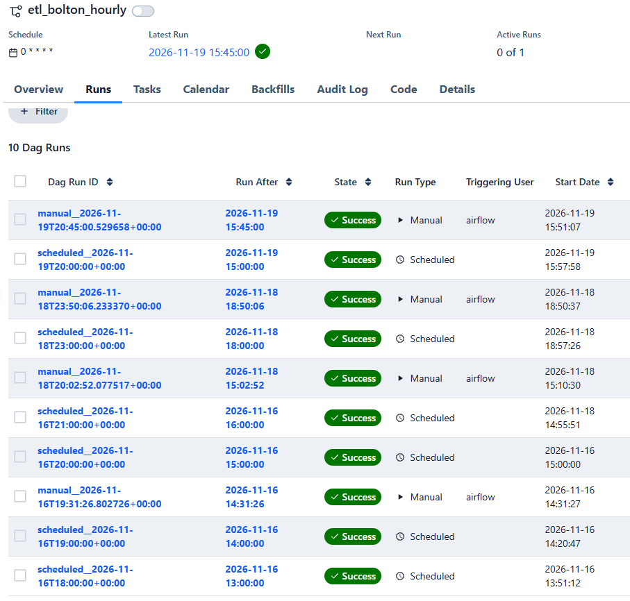
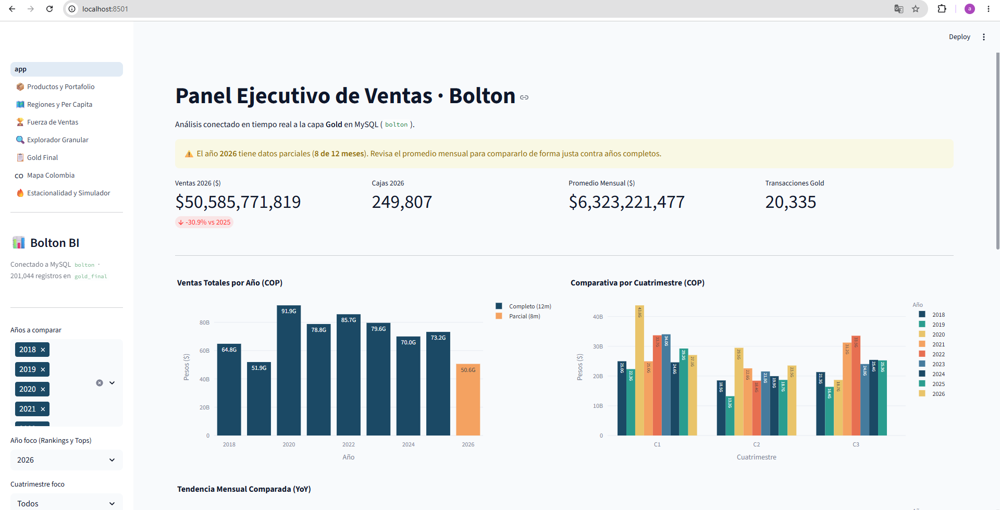

# Informe Bolton — ETL de Resultados Comerciales

*Pipeline ETL con arquitectura medallón para automatizar la generación de reportes comerciales cuatrimestrales*


## Descripción

Cada cuatrimestre, la fuerza de ventas debía presentar sus resultados comerciales
en una reunión de evaluación de desempeño. Antes de este proyecto, ese proceso
implicaba días enteros de trabajo manual, revisar los datos en bruto, calcular
métricas, construir gráficas y armar las diapositivas desde cero.

Más allá del tiempo perdido, esto generaba una carga de presión considerable sobre
el equipo comercial. La preparación de la presentación competía directamente con
el tiempo que deberían estar dedicando a vender, y cualquier error o demora se
traducía en ansiedad frente a una reunión donde los resultados y en algunos casos
la continuidad laboral estaban en juego.

Este proyecto resuelve ese problema mediante un pipeline ETL con arquitectura
medallón que automatiza por completo la extracción,
limpieza, integración y agregación de los datos comerciales. Los resultados ya
procesados se exponen en un dashboard interactivo en Streamlit, donde cada
vendedor puede consultar y capturar directamente sus métricas y gráficas listas
para insertar en su presentación eliminando días de trabajo manual y reduciendo
la incertidumbre y presión asociada a la preparación de este informe.

## Objetivos

### Objetivo general

Automatizar el procesamiento y la visualización de los resultados comerciales
cuatrimestrales mediante un pipeline ETL con arquitectura medallón, eliminando
el trabajo manual de la fuerza de ventas en la preparación de sus presentaciones
de desempeño.

### Objetivos específicos

- Extraer automáticamente los datos de ventas (Excel Bolton) y de referencia
  geográfica (API Colombia) sin intervención manual.
- Limpiar, estandarizar e integrar los datos en una estructura por capas
  (bronze, silver, gold) que garantice trazabilidad y calidad.
- Calcular las métricas e informes clave (ventas por región, top vendedores,
  top productos, indicadores per cápita, comparativos por cuatrimestre, entre
  otros) de forma automática.
- Orquestar todo el proceso con Apache Airflow, asegurando ejecución periódica,
  manejo de errores y reintentos ante fallos transitorios.
- Exponer los resultados mediante una API propia y un dashboard en Streamlit,
  para que la fuerza de ventas pueda consultar y capturar sus resultados sin
  depender de un analista o de procesos manuales.
- Reducir el tiempo de preparación de las presentaciones cuatrimestrales de
  varios días a minutos.

## Tecnologías

| Categoría | Tecnología |
|---|---|
| Lenguaje | Python 3.11+ |
| Procesamiento de datos | Pandas, NumPy |
| Orquestación | Apache Airflow |
| Base de datos | MySQL |
| Conexión a base de datos | SQLAlchemy |
| Extracción de datos | Requests (API), OpenPyXL / python-calamine (Excel) |
| Configuración | PyYAML |
| Manejo de fechas/zonas horarias | Pendulum |
| API | FastAPI |
| Visualización / Dashboard | Streamlit, Plotly |
| Contenedores | Docker |
| Control de versiones | Git / GitHub |

## Arquitectura

El proyecto sigue una arquitectura ETL en capas (medallón), orquestada por
Apache Airflow, desde la extracción de los datos hasta su consumo final en
el dashboard de la fuerza de ventas.


## Fuentes de datos

| Fuente | Origen | Formato | Volumen (bronze) | Periodicidad |
|---|---|---|---|---|
| Ventas Bolton | Archivo interno de la compañía | Excel (.xlsx) | ~308,169 filas, 29 columnas | Diaria, 5:00 a.m. |
| Departamentos de Colombia | API Colombia (`api-colombia.com`) | JSON (vía API REST) | 33 registros | Diaria, 5:00 a.m. |

**Detalle de cada fuente:**

- **Ventas Bolton (`bolton.xlsx`):** contiene el detalle transaccional de ventas:
  año, mes, fecha, factura, cliente, canal, vendedor, zona, producto,
  referencia, marca, familia, categoría, cajas y valor en pesos.
- **API Colombia (`Department`):** provee información geográfica y demográfica
  de los departamentos (población, superficie, ciudad capital, región natural),
  usada para enriquecer las ventas con contexto poblacional y calcular métricas
  per cápita.

### Reducción de volumen a través de las capas

El dato crudo (308,169 filas) se depura en la capa silver aplicando reglas de
calidad de negocio, hasta llegar a 201,044 filas limpias y válidas en gold:

| Motivo de exclusión | Filas eliminadas |
|---|---|
| Sin valor en PESOS (forecast, inventario, líneas vacías) | 60,474 |
| PESOS no convertible a número | 0 |
| Traslado interno (Colomboespañola) | 13,468 |
| Devoluciones (factura negativa o PESOS < 0) | 18,613 |
| PESOS = 0 | 381 |
| Periodo incompleto (sep–dic 2026) | 94 |
| Duplicado exacto por factura | 14,095 |
| **Total filas válidas (gold)** | **201,044** |

> **Nota de orquestación:** el DAG de Airflow (`etl_bolton_hourly`) está
> configurado actualmente con `schedule="0 * * * *"` (cada hora) para fines
> de prueba durante el desarrollo. En producción, el pipeline correría una
> vez al día a las 5:00 a.m., antes del inicio de la jornada comercial.

## Proceso ETL

El pipeline sigue una arquitectura medallón (bronze → silver → gold), donde
cada capa representa un nivel creciente de limpieza, integración y agregación
de los datos.

### Extract (Extracción)

- **`extract_api()`**: consulta el endpoint `Department` de la API Colombia y
  guarda la respuesta cruda como CSV en `data/bronze/departamentos.csv`.
- **`extraer_bolton()`**: lee el archivo Excel de ventas (`bolton.xlsx`) tal
  cual viene, sin transformar valores, dejando todo como texto para no perder
  información en la capa bronze.

### Transform (Transformación)

- **`clean_api()`**: limpia y estandariza los datos de departamentos
  (tipos de dato, nombres de columnas) y los guarda en `data/silver/areas.csv`.
- **`clean_excel()`**: limpia el detalle de ventas aplicando las reglas de
  calidad de negocio: descarta filas sin valor en PESOS, traslados internos,
  devoluciones, valores en cero, periodos incompletos y duplicados exactos.
  Resultado: `data/silver/bolton_silver.csv`.
- **`integrar_silver()`**: combina el detalle de ventas limpio con la
  información geográfica de departamentos (vía el mapeo de regiones definido
  en `config.yaml`), agregando población total y departamentos asociados a
  cada registro. Resultado: `data/silver/silver_integrado.csv`.
- **`build_gold()`**: agrega el cálculo de cuatrimestre y periodo, dejando
  el dataset final listo para análisis en `data/gold/gold_final.csv`.
- **`generar_informes()`**: a partir de gold_final, calcula los informes
  agregados de negocio: ventas por año, por cuatrimestre, top ciudades,
  top productos, top vendedores, indicadores per cápita, y comparativos por
  marca/región — cada uno como un CSV independiente en `data/gold/`.

### Load (Carga)

- **`load()`**: carga cada capa (bronze, silver, gold e informes) como
  tablas independientes en MySQL, creando los esquemas desde cero en cada
  ejecución, verificando conteo de filas y reconciliando sumas de valores
  (pesos) entre el archivo origen y la tabla cargada, para garantizar que
  no se pierda ni se duplique información durante la carga.

### Consumo

Una vez los datos están en MySQL, una API construida en **FastAPI** expone
los resultados, y el **dashboard en Streamlit** los consume para mostrar
gráficas (con Plotly) y métricas que la fuerza de ventas puede capturar
directamente para sus presentaciones.

## Estructura del proyecto

```
informebolton/
│
├── api/                       # API construida en FastAPI, expone los datos de MySQL
│
├── dashboard/                 # Dashboard en Streamlit (consumo final para fuerza de ventas)
│   ├── .streamlit/             # Configuración de la app Streamlit
│   ├── pages/                  # Páginas del dashboard
│   └── src/                    # Lógica auxiliar del dashboard
│
├── data/                      # Datos en cada etapa del pipeline
│   ├── bronze/                 # Datos crudos tal cual llegan de las fuentes
│   ├── silver/                 # Datos limpios, validados e integrados
│   └── gold/                    # Datos agregados listos para consumo (informes)
│
├── src/                       # Código fuente del pipeline ETL
│   ├── extract/                 # Funciones de extracción (API, Excel)
│   ├── transform/                # Funciones de limpieza, integración y agregación
│   └── load/                     # Carga de datos a MySQL
│
├── notebooks/                 # Exploración de datos (EDA)
│
├── test/                      # Pruebas de integridad de datos (extract, gold)
│
├── config/                    # Configuración centralizada del proyecto (config.yaml)
│
├── docs/                      # Documentación del proyecto (arquitectura, diccionario de datos)
│
├── assets_readme/             # Capturas de evidencia (tests, Airflow, dashboard)
│
├── logs/                      # Logs de ejecución del pipeline
│
├── main.py                    # Orquestador del pipeline (ejecución local)
├── requirements.txt
├── .gitignore
├── .env.example
├── README.md
└── LICENSE
```

**Descripción de las carpetas principales:**

- **`api/`**: expone mediante FastAPI los datos ya procesados en MySQL, para
  que el dashboard los consuma sin acceder directamente a la base de datos.
- **`dashboard/`**: aplicación Streamlit donde la fuerza de ventas visualiza
  y captura sus resultados comerciales listos para presentar.
- **`data/`**: almacena los datos en cada capa de la arquitectura medallón,
  permitiendo trazabilidad completa desde el dato crudo hasta el agregado final.
- **`src/`**: contiene toda la lógica del ETL, organizada por responsabilidad
  (extracción, transformación, carga).
- **`test/`**: valida la integridad de los datos extraídos y cargados,
  verificando existencia, ausencia de nulos en campos clave, valores
  negativos inválidos y reconciliación de totales entre capas.
- **`config/`**: centraliza toda la configuración del proyecto (rutas,
  credenciales de API, nombres de archivo, mapeo de regiones) en un único
  archivo YAML.
- **`docs/`**: documentación de soporte del proyecto (diagrama de
  arquitectura y diccionario de datos).

## Instalación

### Requisitos previos

- Python 3.11.9
- MySQL (local o en contenedor Docker), ya instalado y accesible
- Docker y Docker Compose (para Apache Airflow)
- Git

### Estructura del repositorio

Este repositorio (`bolton`) contiene dos proyectos relacionados:

```
bolton/
├── airflow-medallon/      # Orquestación: DAG, Docker Compose, Dockerfile de Airflow
└── informebolton/          # Proyecto ETL completo: extracción, transformación, carga, API y dashboard
```

### 1. Clonar el repositorio

```bash
git clone https://github.com/<tu-usuario>/bolton.git
cd bolton
```

### 2. Configurar el proyecto ETL (`informebolton/`)

```bash
cd informebolton
python -m venv venv

# Windows
venv\Scripts\activate
# Linux / macOS
source venv/bin/activate

pip install -r requirements.txt
```

### 3. Configurar variables de entorno

El repositorio incluye `.env.example`, una plantilla que indica qué variables
de entorno necesita el proyecto, sin valores reales. Cópiala y crea tu propio
`.env` (este último no se sube al repositorio, por seguridad):

```bash
cp .env.example .env
```

Edita `informebolton/.env` con tus credenciales reales de MySQL:
```env
DB_USER=tu_usuario
DB_PASSWORD=tu_password
```

Todas las rutas, nombres de archivo y demás configuración del proyecto ya
están definidas en `config/config.yaml` de forma relativa, por lo que no
requieren ajustes manuales.

### 4. Tener MySQL disponible

El pipeline requiere un servidor MySQL accesible, crea automáticamente la
base de datos y las tablas necesarias al ejecutarse.

### 5. Instalar y levantar Apache Airflow

Airflow corre en un entorno Docker independiente, con sus propias
dependencias (`requirements-airflow.txt`) y configuración. Desde `airflow-medallon/`:

```bash
cd ../airflow-medallon
docker compose up airflow-init
docker compose up -d
```

Airflow monta el proyecto `informebolton/` completo como volumen, por lo
que tiene acceso directo al código del ETL, configuración, `.env` y datos.

Una vez levantado, la interfaz web de Airflow estará disponible en:
`http://localhost:8081` (usuario: `airflow`, contraseña: `airflow`).

## Ejecución

Existen dos formas de correr el pipeline ETL: localmente con `main.py`
(para pruebas rápidas) o mediante Airflow (orquestación real, programada).

### Opción A — Ejecución local directa (sin Airflow)

Desde `informebolton/`, con el entorno virtual activado:

```bash
python main.py
```

Esto ejecuta el pipeline completo en secuencia: extracción, limpieza,
integración, generación de informes y carga a MySQL.

### Opción B — Ejecución orquestada con Airflow

1. Levanta Airflow (ver sección de Instalación):
   ```bash
   cd airflow-medallon
   docker compose up -d
   ```
2. Abre `http://localhost:8081` (usuario y contraseña: `airflow`)
3. El DAG `etl_bolton_hourly` corre automáticamente cada hora según su
   schedule, o puede dispararse manualmente desde la UI (▶) en cualquier momento.

### Levantar la API (FastAPI)

Desde `informebolton/`:

```bash
uvicorn api.main:app --reload
```

La API estará disponible en `http://127.0.0.1:8000`, con documentación
interactiva en `http://127.0.0.1:8000/docs`.

### Levantar el Dashboard (Streamlit)

Desde `informebolton/dashboard/`:

```bash
cd dashboard
streamlit run app.py
```

El dashboard estará disponible en `http://localhost:8501`.

> **Nota:** para que el dashboard y la API muestren datos, el pipeline ETL
> debe haberse ejecutado al menos una vez (Opción A o B) y haber cargado
> los datos en MySQL.

## Resultados y validaciones

### Datos procesados

El pipeline transforma el dato crudo de ventas (308,169 filas) hasta un
dataset limpio y agregado de 201,044 filas válidas en la capa gold,
aplicando reglas de calidad de negocio en el camino:

| Motivo de exclusión | Filas eliminadas |
|---|---|
| Sin valor en PESOS (forecast, inventario, líneas vacías) | 60,474 |
| Traslado interno (Colomboespañola) | 13,468 |
| Devoluciones (factura negativa o PESOS < 0) | 18,613 |
| PESOS = 0 | 381 |
| Periodo incompleto (sep–dic 2026) | 94 |
| Duplicado exacto por factura | 14,095 |
| **Total filas válidas (gold)** | **201,044** |

A partir de gold_final se generan 13 informes agregados (ventas por año,
por cuatrimestre, top ciudades, top productos, top vendedores, indicadores
per cápita y comparativos por marca/región), todos cargados en MySQL.

### Pruebas de integridad (extract)

Se verificó que ambas fuentes de bronze (API Colombia y Excel Bolton)
generan archivos con datos, sin columnas completamente vacías, y que
pueden integrarse sin errores.



### Pruebas de integridad (transform / gold)

Se validó directamente en MySQL, de forma independiente al proceso de carga:
ausencia de nulos en campos clave (vendedor, región, producto, pesos),
ausencia de valores negativos en pesos y cajas, y reconciliación de totales
entre `gold_final` y los informes agregados (`gold_por_anio`).



### Validación integrada en la carga (load)

Más allá de los scripts de prueba independientes, la propia función `load()`
valida cada tabla en el momento de la carga: compara el conteo de filas del
archivo origen contra las filas insertadas en MySQL, y reconcilia la suma de
`pesos` entre el archivo y la tabla — deteniendo el proceso (`RuntimeError`)
si algo no cuadra. El log de una carga exitosa confirma esto para las 17
tablas (bronze, silver, gold e informes):



Ningún conteo ni reconciliación de sumas falló, confirmando que no se
perdieron ni duplicaron registros entre el archivo y la base de datos.

### Manejo de errores en la orquestación (Airflow)

El DAG `etl_bolton_hourly` incorpora validaciones automáticas en dos puntos
críticos del pipeline:

| Validación | Tarea | Qué detecta |
|---|---|---|
| Bronze no vacío ni inexistente | `validar_bronze` | Archivos corruptos o fallos de extracción |
| Columnas requeridas presentes | `validate_gold` | Cambios inesperados en la estructura de datos |
| Nulos en campos clave (año, mes, pesos) | `validate_gold` | Datos incompletos antes de cargar a MySQL |
| Rango válido de "mes" (1-12) | `validate_gold` | Errores de transformación o parsing de fechas |
| Valores infinitos en columnas numéricas | `validate_gold` | Errores de cálculo (ej. división por cero en per cápita) |

Si cualquiera de estas validaciones falla, la tarea lanza `AirflowFailException`,
deteniendo el pipeline y evitando que datos corruptos lleguen a MySQL. Además,
toda tarea cuenta con 2 reintentos automáticos (5 minutos de espera) para
tolerar fallos transitorios sin intervención manual.



### Resultado final: Dashboard

El resultado del pipeline se consume en un dashboard interactivo, donde la
fuerza de ventas puede explorar sus resultados comerciales y capturar
gráficas listas para sus presentaciones cuatrimestrales, sin necesidad de
procesar datos manualmente.



## Autores

- Juan Pablo Castillo
- Joseph Marín
- Alejandro Marín
- Jose Alfredo Gonzalías *(verificar ortografía del apellido)*

**Proyecto desarrollado como parte de la automatización de resultados
comerciales cuatrimestrales — arquitectura ETL medallón, orquestación con
Apache Airflow, API en FastAPI y dashboard en Streamlit.**
